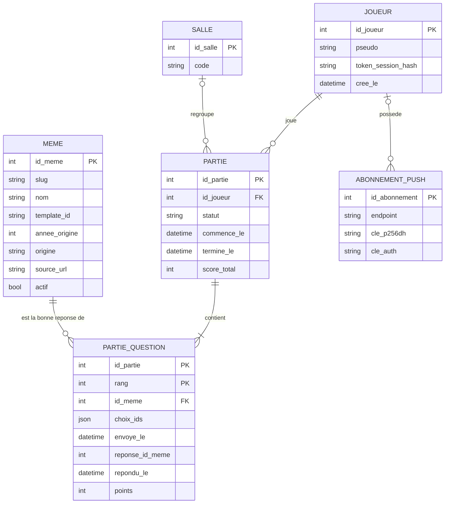

# MEMEQUIZZ — Stack, cartographies à produire et modélisation BDD

TP Fullstack (35h) — quiz de mèmes style Kahoot : une image de mème, 4 noms au choix, un chrono, un score selon la rapidité, un classement. Les réponses sont vérifiées côté serveur.

---

## 1. Stack retenue

| Couche             | Choix                                                                                                                                                         | Pourquoi                                                      |
| ------------------ | ------------------------------------------------------------------------------------------------------------------------------------------------------------- | ------------------------------------------------------------- |
| Runtime / paquets  | **Bun** (fallback Node pour le runtime final, comparaison prévue dans SCRUM-80)                                                                               | Rapide, installe et lance TypeScript directement              |
| Framework          | **Next.js** (App Router, route handlers, sortie `standalone`) + **TypeScript strict**                                                                         | Exigé par le TP (méta-framework + TS), permet CSR / SSR / SSG |
| Base de données    | **PostgreSQL** + **Drizzle ORM** (migrations + seed)                                                                                                          | Relationnel, typé, adapté à Merise                            |
| Validation         | **Zod** (schémas partagés client / serveur)                                                                                                                   | Entrées invalides rejetées en 400                             |
| UI / accessibilité | Maquette **Figma** → composants React, WCAG 2.2, axe, Lighthouse                                                                                              | Exigé par le TP                                               |
| PWA                | Manifest, service worker, mode hors-ligne, push (VAPID)                                                                                                       | Exigé par le TP                                               |
| Tests              | **Vitest** (unitaires + intégration), **Playwright** (E2E + axe)                                                                                              | Couverture + seuil en CI                                      |
| Sécurité           | CSP avec nonce (middleware), XSS, CSRF, secrets en `.env`, rate limiting                                                                                      | Exigé par le TP                                               |
| Déploiement        | **Docker** multi-stage (image non-root + healthcheck) + `docker-compose` (app + PostgreSQL + volume) + **Caddy** (reverse proxy + HTTPS auto) sur ton **VPS** | HTTPS obligatoire pour la PWA et le push                      |
| Temps réel (bonus) | **SSE** d'abord ; WebSocket Bun séparé seulement si SSE ne suffit pas                                                                                         | Les réponses restent des POST                                 |
| Données mèmes      | **memegen.link** (id, nom, image) + fiches complétées avec **Wikipédia FR** (année, origine, source) ; sélection manuelle d'environ 40 mèmes                  | Pas d'API française toute prête                               |

Points d'attention déjà identifiés :

- Les images de mèmes sont protégées par le droit d'auteur : décision écrite à prendre (SCRUM-34).
- Les noms de memegen.link sont en anglais et certains sont des phrases : curation manuelle indispensable.
- Wikipédia FR est sous licence CC BY-SA : reformuler et citer la source.

---

## 2. Arborescence cible et rendu par page

| Route                                    | Rôle                                                       | Rendu                        |
| ---------------------------------------- | ---------------------------------------------------------- | ---------------------------- |
| `/`                                      | Accueil, pseudo, lancer une partie                         | SSG                          |
| `/jeu`                                   | Partie (10 questions, chrono 15 s)                         | CSR (interactif)             |
| `/resultat/[partieId]`                   | Score final                                                | SSR                          |
| `/classement`                            | Meilleurs scores                                           | SSR (données fraîches)       |
| `/memes/[slug]`                          | Fiche d'un mème                                            | SSG (`generateStaticParams`) |
| `/stats-csr`, `/stats-ssr`, `/stats-ssg` | Même page de stats en 3 modes pour comparer les Web Vitals | CSR / SSR / SSG              |
| `/hors-ligne`                            | Page de secours PWA                                        | Statique                     |
| `/entrainement`                          | Mode hors-ligne avec questions en cache                    | CSR + service worker         |

---

## 3. Cartographies et diagrammes à produire

À faire dans l'ordre, chacun alimente le suivant. La colonne « Version » correspond aux versions Jira (label `vX.Y`).

| #   | Livrable                                             | Contenu                                                                                                                                  | Outil conseillé                               | Version |
| --- | ---------------------------------------------------- | ---------------------------------------------------------------------------------------------------------------------------------------- | --------------------------------------------- | ------- |
| 1   | **Cartographie fonctionnelle**                       | Acteurs (joueur, admin/seed) et cas d'usage : jouer, voir le classement, consulter une fiche, installer la PWA, recevoir le quiz du jour | draw.io ou Mermaid                            | v0.2    |
| 2   | **Parcours utilisateur (user flow)**                 | Accueil → pseudo → 10 questions → résultat → classement, + parcours hors-ligne                                                           | Figma / FigJam                                | v0.2    |
| 3   | **Arborescence du site**                             | Tableau de la section 2                                                                                                                  | Markdown                                      | v0.2    |
| 4   | **Merise : MCD, MLD, MPD** + dictionnaire de données | Voir section 4                                                                                                                           | Looping (gratuit, Merise français) ou draw.io | v0.3    |
| 5   | **Cartographie des API**                             | Endpoints, méthode, entrée Zod, sortie, codes d'erreur (voir section 5)                                                                  | Markdown / OpenAPI                            | v0.3    |
| 6   | **Diagramme de séquence d'une partie**               | Navigateur → API → base : question, réponse, calcul du score côté serveur                                                                | Mermaid                                       | v0.3    |
| 7   | **Cartographie du rendu**                            | Quelle page est CSR / SSR / SSG et pourquoi, avec le tableau comparatif des Web Vitals                                                   | Markdown                                      | v0.5    |
| 8   | **Schéma d'architecture de déploiement**             | Internet → Caddy (HTTPS) → conteneur Next.js → PostgreSQL (volume), sauvegarde `pg_dump`                                                 | draw.io                                       | v0.8    |
| 9   | **Cartographie sécurité (menaces)**                  | Pour chaque flux : menace (XSS, CSRF, triche sur le score, fuite de secrets, abus de l'API) → parade → test associé                      | Tableau                                       | v0.7    |
| 10  | **Matrice exigences du TP ↔ tickets**                | Chaque exigence du sujet reliée à un ticket SCRUM et à une preuve (capture, test)                                                        | Tableau                                       | v1.0    |

---

## 4. Modélisation de la base (Merise)

### 4.1 Règles de gestion

- Un joueur est identifié par un pseudo (pas de compte, juste une session anonyme).
- Un joueur joue zéro à plusieurs parties ; une partie appartient à un seul joueur.
- Une partie contient 10 questions, chacune portant sur un mème. Un mème peut apparaître dans plusieurs parties.
- Pour chaque question, on mémorise les 4 choix proposés, l'heure d'envoi, la réponse donnée, l'heure de réponse et les points. Le calcul se fait uniquement côté serveur, à partir de l'écart entre l'heure d'envoi et l'heure de réponse.
- Le classement n'est pas une table : c'est une requête sur les scores des parties terminées.
- Un abonnement push est lié à un navigateur et peut être rattaché à un joueur.
- Bonus : une salle regroupe plusieurs parties jouées en même temps (code à partager).

### 4.2 Dictionnaire de données (extrait)

| Donnée           | Type                     | Règle                                           |
| ---------------- | ------------------------ | ----------------------------------------------- |
| pseudo           | texte, 3 à 20 caractères | nettoyé, échappé à l'affichage                  |
| nom_meme         | texte                    | nom affiché comme bonne réponse                 |
| template_id      | texte                    | identifiant memegen.link (ex. `drake`)          |
| annee_origine    | entier                   | nullable                                        |
| source_url       | texte                    | lien vers l'article Wikipédia FR                |
| statut_partie    | énumération              | en_cours, terminee, abandonnee                  |
| delai_reponse_ms | entier                   | calculé serveur                                 |
| points           | entier                   | 0 si faux, sinon fonction décroissante du délai |

### 4.3 MCD (entités, associations, cardinalités)

```
JOUEUR (id_joueur, pseudo, cree_le)
   1,1 ──── JOUER ──── 0,N
PARTIE (id_partie, statut, commence_le, termine_le, score_total)

PARTIE
   1,N ──── QUESTIONNER ──── 0,N      (association porteuse de propriétés)
MEME (id_meme, slug, nom, template_id, annee_origine, origine, source_url, actif)

QUESTIONNER porte : rang, choix_propose (4 mèmes), envoye_le,
                    reponse_donnee, repondu_le, points

ABONNEMENT_PUSH (id_abonnement, endpoint, cle_p256dh, cle_auth, cree_le)
   0,1 ──── APPARTENIR ──── 0,N  JOUEUR

(Bonus) SALLE (id_salle, code) 1,1 ──── REGROUPER ──── 0,N PARTIE
```

Les cardinalités se lisent « côté entité » : un joueur est lié à 0 à N parties (`0,N` côté JOUEUR), et une partie à exactement un joueur (`1,1` côté PARTIE). À vérifier avec ton professeur sur ta notation (le sens des cardinalités varie selon les cours).

### 4.4 MLD (modèle logique relationnel)

```
joueur(id_joueur PK, pseudo, token_session_hash, cree_le)
meme(id_meme PK, slug UNIQUE, nom, template_id, annee_origine, origine, source_url, actif)
partie(id_partie PK, #id_joueur, #id_salle NULL, statut, commence_le, termine_le, score_total)
partie_question(#id_partie, rang, #id_meme, choix_ids, envoye_le,
                reponse_id_meme NULL, repondu_le NULL, points)
                PK (id_partie, rang)
abonnement_push(id_abonnement PK, #id_joueur NULL, endpoint UNIQUE, cle_p256dh, cle_auth, cree_le)
salle(id_salle PK, code UNIQUE, cree_le)            -- bonus
```

Version visuelle (Mermaid, s'affiche dans GitHub / VS Code) :



### 4.5 MPD (physique, PostgreSQL via Drizzle)

À écrire dans `schema.ts` (ticket SCRUM-35) : types `serial`/`integer`, `varchar`, `timestamp with time zone`, `jsonb` pour `choix_ids`, `enum` pour `statut`, clés étrangères avec `ON DELETE`, index sur `partie.score_total` (classement) et `meme.slug`. Les migrations doivent être rejouables et le seed recrée la base vide en une commande (SCRUM-36).

### 4.6 À ne pas oublier

- Ne jamais renvoyer la bonne réponse dans la réponse HTTP de la question (`GET`).
- Ne jamais faire confiance au score envoyé par le client.
- Garder un test de migration sur base vide.

---

## 5. Cartographie des API (première version)

| Méthode | Route                       | Entrée (Zod)                     | Sortie                                                 | Erreurs                         |
| ------- | --------------------------- | -------------------------------- | ------------------------------------------------------ | ------------------------------- |
| POST    | `/api/parties`              | `{ pseudo }`                     | `{ partieId }`                                         | 400 pseudo invalide, 429        |
| GET     | `/api/parties/:id/question` | —                                | `{ rang, imageUrl, choix[4] }` (sans la bonne réponse) | 404, 409 partie terminée        |
| POST    | `/api/parties/:id/reponse`  | `{ rang, choixId }` + jeton CSRF | `{ correct, points, scoreTotal, bonneReponse }`        | 400, 403 CSRF, 409 déjà répondu |
| GET     | `/api/classement`           | `?limite=`                       | `[{ pseudo, score }]`                                  | —                               |
| GET     | `/api/memes/:slug`          | —                                | fiche du mème                                          | 404                             |
| POST    | `/api/push/abonnement`      | abonnement push                  | `204`                                                  | 400                             |

La bonne réponse n'est révélée qu'**après** le POST de réponse.

---

## 6. Pourquoi le tableau Jira n'affiche que 2 tâches

Ton tableau est un tableau **Scrum**, et un tableau Scrum n'affiche que les tickets du **sprint actif** (le bouton « Terminer le sprint » en haut le confirme). Le sprint en cours contient seulement SCRUM-1 et SCRUM-2, les deux tâches d'exemple créées avec le projet. Les 78 tickets du backlog (SCRUM-16 à 93) sont bien là, mais ils sont dans le **Backlog**, hors sprint, donc invisibles sur le tableau. Rien n'a été perdu.

Les colonnes **To Do / In Progress / In Review / Done** sont les statuts du projet. La colonne In Review est celle que tu as ajoutée.

### Pour les faire apparaître, étape par étape

1. Clique sur **Terminer le sprint** (les tâches d'exemple partent avec), ou supprime d'abord SCRUM-1 à 4 si tu ne veux pas les garder.
2. Va dans l'onglet **Backlog**.
3. Filtre sur la version : barre de recherche ou **Filtrer → Étiquettes → v0.1** (11 tickets).
4. Clique sur **Créer un sprint**, nomme-le « Sprint v0.1 ».
5. Glisse les tickets v0.1 dans ce sprint (sélection multiple avec Ctrl/Cmd + clic).
6. Clique sur **Démarrer le sprint**.
7. Retourne sur **Tableau** : les tickets de v0.1 sont dans To Do.

À répéter pour chaque version (v0.2, v0.3, etc.) : un sprint par version, c'est la correspondance la plus simple avec le découpage fait dans le backlog.

---

## 7. Ordre de travail conseillé

1. v0.1 : dépôt, Next.js + TS, lint, CI, Dockerfile, compose, premier déploiement sur le VPS, checklist de posture critique.
2. v0.2 : cartographies 1 à 3, Figma, design tokens, composants, accessibilité de base.
3. v0.3 : **Merise (MCD → MLD → MPD)**, schéma Drizzle, seed des mèmes, API question / réponse, pages de jeu et de classement.
4. v0.4 à v1.0 : PWA, rendu CSR/SSR/SSG, tests, sécurité, production Docker + Caddy, bonus multijoueur, livraison et oral.
